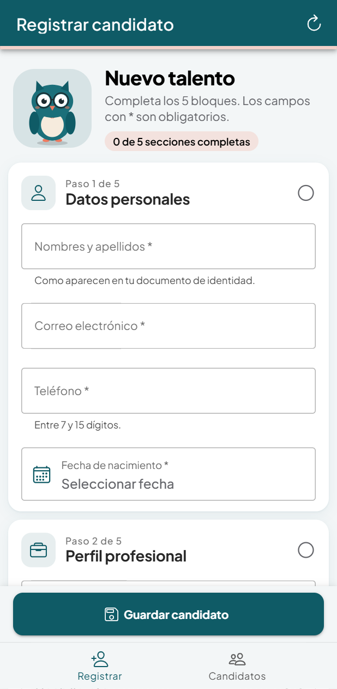
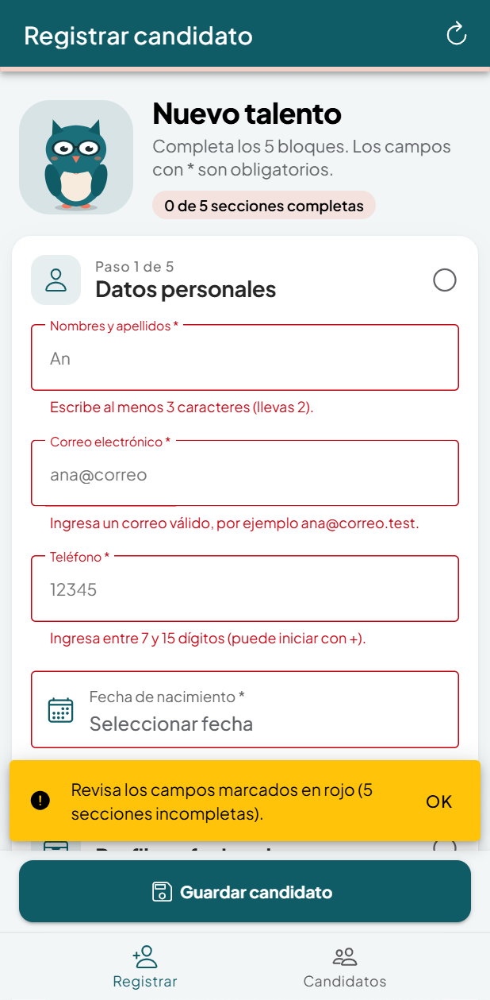
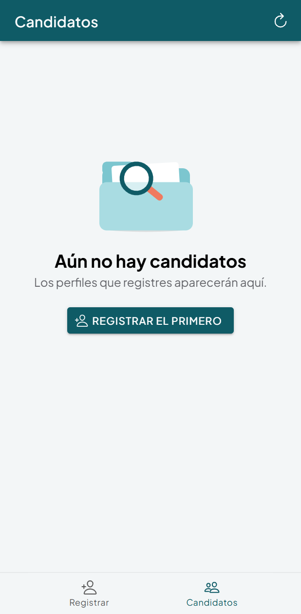
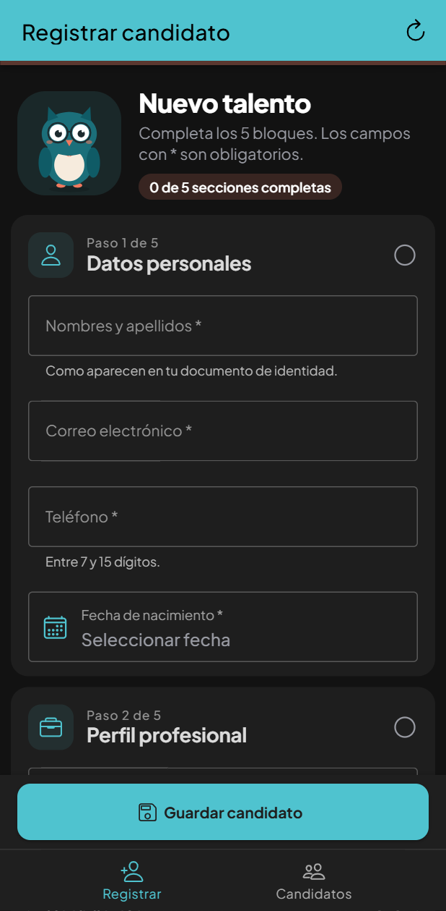
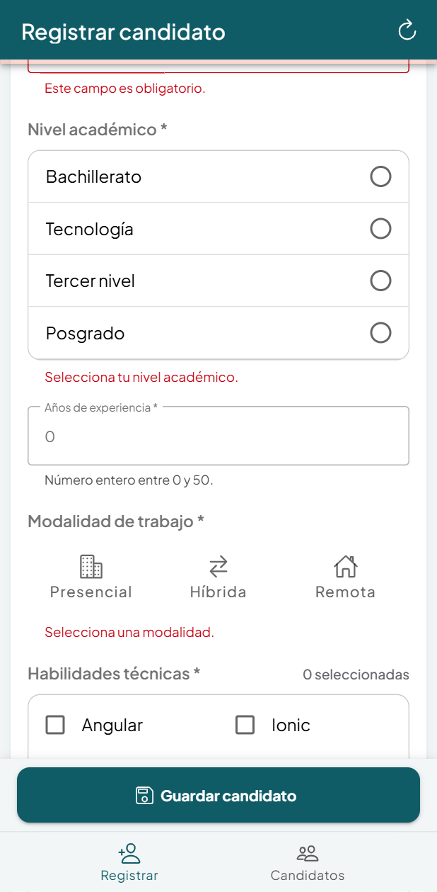
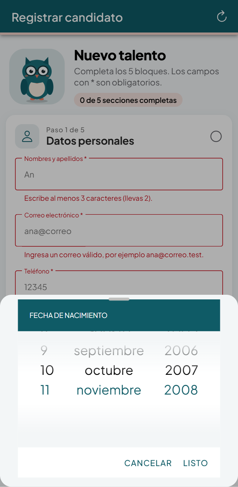

# 🧑‍💼 TalentFlow — Registro empresarial de hojas de vida

Aplicación móvil hecha con **Ionic + Angular (standalone)** y **Firebase Cloud Firestore** para que el equipo de Talento Humano de la empresa ficticia **TalentFlow S. A.** registre y consulte perfiles de candidatos con datos estructurados.

> Taller guiado de **Desarrollo de Aplicaciones Móviles**. Prototipo funcional (MVP) que solo usa **datos ficticios**.

| Formulario | Validaciones | Lista sin candidatos | Modo oscuro |
|:---:|:---:|:---:|:---:|
|  |  |  |  |

---

## 1. Problema empresarial

TalentFlow S. A. recibe hojas de vida por correo electrónico, y el equipo de Talento Humano no tiene una forma ordenada de organizar ni comparar los perfiles. La aplicación reemplaza ese flujo por un **formulario digital validado**. Los datos se guardan en la nube como **documentos consultables** de la colección `candidatos` en Cloud Firestore, y desde la misma app se puede ver la lista y el detalle de cada postulante.

## 2. Integrantes

| Integrante | Rol |
|---|---|
| **Carlos Puente** | Desarrollo completo (trabajo individual) |

## 3. Objetivo y funcionalidades

**Objetivo:** registrar, validar, almacenar y consultar perfiles profesionales usando componentes de formulario de Ionic y persistencia en Firebase Cloud Firestore.

**Funcionalidades implementadas**

- ✅ **Registrar candidato:** formulario en **5 bloques** (Datos personales, Perfil profesional, Disponibilidad, Presentación y Consentimiento), con barra de progreso y un indicador ✓ en cada bloque completo.
- ✅ **Validación antes de enviar:** cada error aparece **junto a su campo**. Si el formulario es inválido, la pantalla baja al primer error, se muestra un aviso y **no se llama a Firebase**.
- ✅ **Guardado** de cada candidato como documento nuevo en `candidatos`, con marca de tiempo `creadoEn: serverTimestamp()`.
- ✅ **Indicador de carga** al guardar (overlay con spinner) y al consultar (esqueleto de la lista).
- ✅ **Mensajes de éxito y error** con `ion-toast`. Si falla el guardado, los datos **se conservan** en el formulario.
- ✅ **Limpieza del formulario** después de guardar correctamente. También hay un botón para limpiar con confirmación (`ion-alert`).
- ✅ **Consultar candidatos:** lista leída de Firestore, de la más reciente a la más antigua, con **nombre, cargo, modalidad y experiencia**.
- ✅ **Detalle completo** de cada candidato en un `ion-modal` con formato de hoja de vida (correo y teléfono se pueden tocar para escribir o llamar).
- ✅ Recarga deslizando hacia abajo (`ion-refresher`), estado vacío y estado de error con botón **Reintentar**.
- ✅ Manejo de **falta de conexión**: aviso inmediato y tiempo máximo de espera de 15 s.

**Mejoras adicionales (opcionales)**

- 🎨 Tema propio (azul petróleo y coral, fuente Plus Jakarta Sans) con **modo oscuro** automático.
- 🦉 **Animaciones Rive:** *Flo*, un búho reclutador que reacciona cuando el formulario tiene errores o se guarda bien, y una lupa animada cuando la lista está vacía (ver [§ 10](#10-animaciones-rive)).
- 📱 Plataforma **Android** (Capacitor 8) para generar un APK de prueba.
- ♿ Animaciones decorativas (`aria-hidden`) que respetan la preferencia de **movimiento reducido** del sistema.

## 4. Tecnologías y componentes Ionic

| Tecnología | Versión | Uso |
|---|---|---|
| Ionic Framework (`@ionic/angular`) | 9 | Componentes de interfaz móvil |
| Angular (standalone, sin zone.js) | 22 | Estructura, Reactive Forms tipados, signals |
| Firebase JS SDK (`firebase/firestore`) | 13 | Persistencia en Cloud Firestore |
| Capacitor | 8 | Empaquetado Android |
| Rive (`@rive-app/canvas` + Rive CLI) | 2.50 | Animaciones vectoriales |
| Vitest | 5 | Pruebas unitarias |

**Componentes Ionic utilizados (más de 25 tipos)**

| Obligatorios | Dónde |
|---|---|
| `ion-input` (`text`, `email`, `tel`, `number`) | Nombres, correo, teléfono, años de experiencia, aspiración salarial |
| `ion-datetime` (dentro de `ion-modal`) | Fecha de nacimiento (rueda) y fecha de disponibilidad (calendario) |
| `ion-radio-group` + `ion-radio` | Nivel académico |
| `ion-select` + `ion-select-option` | Cargo al que postula (menú inferior) |
| `ion-checkbox` | Habilidades técnicas (varias) y consentimiento |
| `ion-textarea` | Resumen profesional (con contador) |
| `ion-button` | Guardar, limpiar, reintentar, cerrar |
| `ion-list` + `ion-item` | Opciones del formulario, lista de candidatos y detalle |

Además: `ion-card` (+ header, title, subtitle, content), `ion-segment` + `ion-segment-button` (modalidad), `ion-toast`, `ion-alert`, `ion-modal`, `ion-spinner`, `ion-progress-bar`, `ion-skeleton-text`, `ion-refresher`, `ion-chip`, `ion-note`, `ion-label`, `ion-list-header`, `ion-tabs` / `ion-tab-bar` / `ion-tab-button`, `ion-header`, `ion-toolbar`, `ion-footer`, `ion-icon`.

## 5. Arquitectura

```
src/app/
├── firebase.ts                         # initializeApp + getFirestore (instancia única)
├── models/candidato.model.ts           # interfaces, opciones (cargos, niveles...) y límites de validación
├── services/candidatos.service.ts      # ÚNICO acceso a Firestore: crear() y listar()
├── validators/candidato.validators.ts  # validadores propios y mensajes de error en español
├── utils/formato.ts                    # formatos de fecha, moneda (USD), edad e iniciales
├── shared/rive-player/                 # componente <app-rive> reutilizable
├── tabs/tabs.page.ts                   # pestañas: Registrar | Candidatos
└── pages/
    ├── registro/                       # formulario (vista 1)
    └── candidatos/                     # lista + modal de detalle (vista 2)
rive-src/                               # fuente de las animaciones (proyecto Rive CLI)
android/                                # proyecto Android generado por Capacitor
docs/capturas/                          # evidencias
```

**Servicio Firebase:** `CandidatosService` concentra toda la comunicación con Firestore, así que los componentes visuales no importan `firebase/firestore`:

- `crear(candidato)` → `addDoc(collection(db, 'candidatos'), { ...candidato, creadoEn: serverTimestamp() })` y devuelve el ID del documento.
- `listar()` → `getDocs(query(collection(db, 'candidatos'), orderBy('creadoEn', 'desc')))` y convierte cada documento en un `Candidato` (el `Timestamp` pasa a `Date`).
- Si no hay conexión falla de inmediato, y a los 15 s si el servidor no responde. Los errores de Firebase (`permission-denied`, `unavailable`, etc.) se traducen a mensajes claros con `mensajeErrorFirestore()`.

El formulario convierte sus valores con `aNuevoCandidato()` antes de guardar: recorta espacios, pasa el correo a minúsculas, convierte los números de texto a `number` y deja las fechas como `YYYY-MM-DD`.

## 6. Modelo de datos

**Colección:** `candidatos` (ID automático). Cada campo es un **atributo independiente** del documento; no se guarda un JSON como texto.

| Campo | Tipo Firestore | Validación en la app |
|---|---|---|
| `nombres` | string | Obligatorio; mínimo 3 caracteres (sin contar espacios) |
| `correo` | string | Obligatorio; formato `usuario@dominio.ext` |
| `telefono` | string | Obligatorio; 7 a 15 dígitos (se ignoran espacios y guiones; `+` opcional) |
| `fechaNacimiento` | string `YYYY-MM-DD` | Obligatoria; no futura; **18 años o más** |
| `cargo` | string | Obligatorio; Desarrollador móvil, Analista de datos, Diseñador UX/UI, Soporte TI |
| `nivelAcademico` | string | Obligatorio; Bachillerato, Tecnología, Tercer nivel, Posgrado |
| `experienciaAnios` | number (entero) | Entero entre 0 y 50 |
| `modalidad` | string | Obligatoria; Presencial, Híbrida o Remota |
| `habilidades` | array\<string\> | Al menos 1: Angular, Ionic, JavaScript, Python, SQL, Git, Firebase |
| `fechaDisponibilidad` | string `YYYY-MM-DD` | Obligatoria; no anterior a hoy |
| `aspiracionSalarial` | number | Mayor que 0 (USD mensuales) |
| `resumen` | string | Obligatorio; 30 a 600 caracteres |
| `consentimiento` | boolean | Debe ser `true` para guardar |
| `creadoEn` | timestamp | Lo asigna el servidor con `serverTimestamp()` |

Las fechas se comparan contra la fecha **local** de hoy y no contra UTC, para que en Ecuador el día no cambie antes de tiempo después de las 19:00.

**Ejemplo de documento (ficticio)**

```json
{
  "nombres": "Ana Pérez",
  "correo": "ana.ejemplo@correo.test",
  "telefono": "0990000000",
  "fechaNacimiento": "2000-04-15",
  "cargo": "Desarrollador móvil",
  "nivelAcademico": "Tercer nivel",
  "experienciaAnios": 3,
  "modalidad": "Híbrida",
  "habilidades": ["Angular", "Ionic", "Git"],
  "fechaDisponibilidad": "2026-12-01",
  "aspiracionSalarial": 1200,
  "resumen": "Desarrolladora de aplicaciones móviles con experiencia en interfaces y servicios web.",
  "consentimiento": true,
  "creadoEn": "2026-11-11T20:28:46.544Z"
}
```

## 7. Instalación y ejecución

**Requisitos:** Node.js 20 o superior, npm y un proyecto de Firebase con Cloud Firestore habilitado. Para el APK: JDK 21 y Android SDK (API 36).

```bash
git clone https://github.com/mangodev-hub/formularios-tensor.git
cd formularios-tensor
npm install
```

**Configurar Firebase**

1. En la consola de Firebase, crea un proyecto y una **app web**, y copia su configuración.
2. Pégala en `src/environments/environment.ts` y `environment.prod.ts`:
   ```ts
   export const environment = {
     production: false,
     firebase: { apiKey: '...', authDomain: '...', projectId: '...', storageBucket: '...', messagingSenderId: '...', appId: '...' },
   };
   ```
3. Habilita **Cloud Firestore** y publica las reglas de práctica de la [§ 9](#9-seguridad-y-limitaciones). La colección `candidatos` se crea sola con el primer registro.

> La configuración **web** de Firebase identifica al proyecto y no es secreta; lo que protege los datos son las reglas. Nunca subas cuentas de servicio ni claves privadas.

**Ejecutar**

```bash
npm start              # http://localhost:4200 (en el navegador, usa la vista de dispositivo móvil)
npm run test:unit      # pruebas unitarias (Vitest)
npm run lint           # ESLint + Prettier
npm run android:apk    # APK de prueba → android/app/build/outputs/apk/debug/app-debug.apk
```

El APK es de tipo **debug**: sirve para instalarlo a mano en un teléfono (`adb install -r app-debug.apk`) y no se publica en ninguna tienda. Necesita internet para usar Firestore.

## 8. Evidencias y pruebas

### Capturas

| Formulario por bloques | Errores junto a cada campo | Errores en radio, segment y checkbox | Selector de fecha |
|:---:|:---:|:---:|:---:|
|  |  |  |  |

| Lista sin candidatos (animación Rive) | Modo oscuro |
|:---:|:---:|
|  |  |

Todas las capturas son de la app real en un viewport de Pixel 7, con datos ficticios.

### Casos de prueba

Probados en la app con Microsoft Edge emulando un Pixel 7 y contra el proyecto real de Firestore.

| # | Caso | Entrada | Resultado esperado | Resultado obtenido |
|---|---|---|---|---|
| 1 | Registro válido | Candidato ficticio completo (Ana Pérez) | Se crea un documento en `candidatos` con 13 campos + `creadoEn`, aviso verde y formulario limpio | ✅ Documento creado (`7lFJzDw3nFMDXrpdDpKu`) en unos 3 s; tipos correctos: enteros, booleano, arreglo y timestamp |
| 2 | **Validación fallida:** formulario vacío | Pulsar "Guardar" sin datos | Errores en cada campo, aviso de 5 secciones incompletas y **ninguna** petición a Firebase | ✅ Errores mostrados, la pantalla baja al primer campo, no se guardó nada |
| 3 | **Validación fallida:** datos con formato incorrecto | Nombre `An`, correo `ana@correo`, teléfono `12345` | Mensaje específico bajo cada campo | ✅ "Escribe al menos 3 caracteres (llevas 2)", "Ingresa un correo válido…", "Ingresa entre 7 y 15 dígitos…" (captura 02) |
| 4 | **Validación fallida:** opciones sin seleccionar | Sin nivel académico, modalidad ni habilidades | Error bajo el radio-group, el segment y los checkboxes | ✅ "Selecciona tu nivel académico", "Selecciona una modalidad", "Selecciona al menos una opción" (captura 03) |
| 5 | Guardar sin conexión | Formulario válido sin internet | Aviso rojo y datos conservados | ✅ "Sin conexión a internet… Tus datos siguen en el formulario." |
| 6 | Consultar lista y detalle | Abrir la pestaña Candidatos y tocar una fila | Lista con nombre, cargo, modalidad y experiencia; detalle con todos los campos | ✅ Lista y modal con todos los datos guardados, incluidos `creadoEn` y el ID de Firestore |
| 7 | Persistencia | Recargar la app y abrir Candidatos | Los registros siguen ahí (se leen de Firestore) | ✅ Al cargar la app desde cero aparece el candidato guardado |
| 8 | Consultar sin conexión | Abrir la lista sin internet | Pantalla de error con "Reintentar"; al reconectar, carga | ✅ Error mostrado y recuperación con "Reintentar" |

**Pruebas unitarias:** 24 pruebas en 5 archivos (validadores, modelo, conversión de documentos de Firestore, mensajes de error y formatos), todas pasando con `npm run test:unit`.

## 9. Seguridad y limitaciones

### Reglas de Firestore usadas en la práctica

```
rules_version = '2';
service cloud.firestore {
  match /databases/{database}/documents {
    match /candidatos/{documento} {
      // Permitir consultar candidatos
      allow read: if true;
      // Permitir registrar candidatos
      allow create: if true;
      // No permitir modificar ni eliminar
      allow update, delete: if false;
    }
  }
}
```

Solo exponen la colección `candidatos` y solo las operaciones que la app necesita (leer y crear). Cualquier otra colección queda bloqueada (se comprobó: devuelve 403).

### Por qué **no** sirven para producción

- **No hay autenticación:** cualquier persona que conozca el ID del proyecto puede **leer todos los perfiles** (nombres, correos, teléfonos, salarios). En una app real esos datos son personales y sensibles.
- **No se validan los datos en el servidor:** las validaciones viven solo en la app, así que alguien puede crear documentos falsos o con campos arbitrarios llamando a la API directamente.
- **No hay límite de escritura:** se podría llenar la base de datos de basura (abuso de cuota).
- El consentimiento del formulario es parte del ejercicio de interfaz y **no reemplaza** una política de privacidad.

### Cómo se restringiría en una aplicación empresarial

1. **Firebase Authentication** con cuentas corporativas y **roles** (custom claims): solo el personal de Talento Humano puede leer; el candidato solo crea y ve su propio perfil (`request.auth.uid == resource.data.uid`).
2. **Validación en las reglas** con `request.resource.data`: campos permitidos (`keys().hasOnly([...])`), tipos (`is string`, `is int`), rangos (`experienciaAnios >= 0 && experienciaAnios <= 50`) y `creadoEn == request.time`.
3. **Firebase App Check** para aceptar solo peticiones de la app oficial, más límites de frecuencia.
4. Datos sensibles (salario, contacto) en una subcolección con acceso más restringido, y auditoría de accesos.

> **Al terminar las pruebas del taller hay que cerrar las reglas públicas** (`allow read, write: if false;`).

### Limitaciones conocidas

- No hay edición, eliminación, autenticación ni carga de archivos PDF (fuera del alcance del taller).
- Lectura con `getDocs` sin paginación: para cientos de registros habría que paginar (`limit` + `startAfter`).
- Las animaciones Rive se publicaron con el **plan gratuito**, que muestra la pantalla "RIVE" (~1,5 s) al iniciar cada animación.

## 10. Animaciones Rive

Las animaciones se crearon como **código** con la Rive CLI, en [`rive-src/`](rive-src/): [`generar.mjs`](rive-src/generar.mjs) produce `scene.rml`, que se compila y publica en `src/assets/rive/talentflow.riv`. La app las reproduce con el componente reutilizable `<app-rive>`. Si el archivo no carga, se muestra un ícono de Ionic en su lugar, y las animaciones nunca bloquean el formulario.

| Artboard | Dónde | Comportamiento |
|---|---|---|
| **Flo** (búho reclutador) | Encabezado del formulario | Respira y parpadea en reposo; ladea la cabeza cuando el formulario tiene errores (`error`) y salta al guardar (`celebrar`) |
| **Vacío** | Lista sin candidatos | Una lupa revisa una carpeta vacía en bucle |
| **Envío** (avión de papel → nube) | Incluido en el `.riv` pero desactivado | Con el plan gratuito, la pantalla "RIVE" ocupaba casi todo el guardado. Se activa con `ANIMACIONES_RIVE.envio = true` y un plan sin marca de agua. |

Las animaciones se manejan con **view models** (triggers), el mecanismo actual que recomienda Rive en lugar de los inputs de state machine, que están obsoletos.

## 11. Distribución del trabajo

Trabajo **individual**: Carlos Puente se encargó del análisis, el diseño de la interfaz, el desarrollo Ionic/Angular, la integración con Firestore, las animaciones Rive, las pruebas y la documentación.

---

<sub>Proyecto académico. Todos los datos mostrados son ficticios.</sub>
